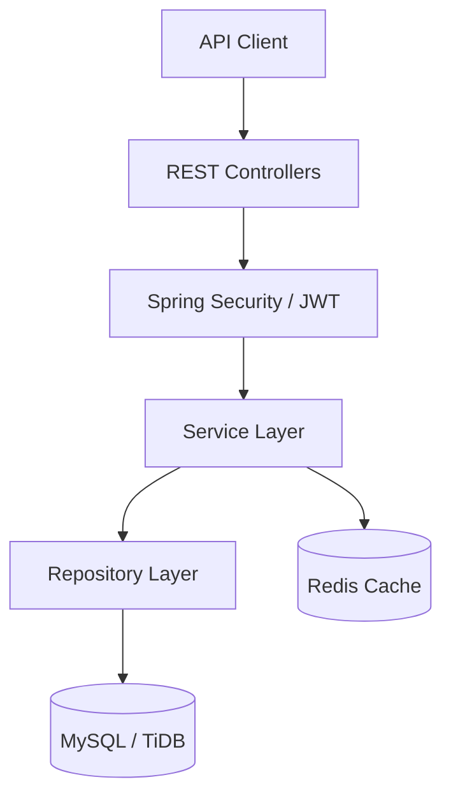

<h1 align="center">Nitish Pala</h1>

<h3 align="center">
Java Backend Developer | Software Engineer
</h3>

  Java • Spring Boot • REST APIs • Kafka • Redis • SQL

  Hyderabad, India | Ex-D. E. Shaw | Ex-Amazon Intern
   
  <b>Open to Work | Immediate Joiner</b>

  
  
  
  

---

## About Me

Backend-focused software engineering professional with nearly
**3 years of professional experience at D. E. Shaw India**
and previous internship experience at **Amazon**.

Experienced in REST API development, service integration,
financial data processing, CI/CD, production troubleshooting,
and application reliability.

My primary technical focus is **Java backend development**,
with an interest in building secure, scalable, reliable,
and maintainable software systems.

- **Backend:** Java, Spring Boot, REST APIs, Hibernate
- **Data & Messaging:** SQL, MySQL, PostgreSQL, Kafka, Redis
- **Engineering:** Concurrency, Transactions, System Design, CI/CD
- **Problem Solving:** 527 LeetCode problems | Rating 1661
- **Availability:** Immediate Joiner

Currently seeking **Java Backend Developer, Software Engineer,
and SDE1 opportunities**.

---

## Technical Skills

### Languages

### Backend Development

### Databases, Caching & Messaging

### DevOps & Development Tools

### Testing

### Core Engineering Concepts

- Object-Oriented Programming and SOLID Principles
- Design Patterns and Low-Level Design
- Data Structures and Algorithms
- Multithreading and Concurrency
- Database Transactions and ACID Properties
- Database Indexing and Query Optimization
- Caching and Idempotency
- Event-Driven Architecture Fundamentals

---

## Featured Project

### E-Commerce Order & Inventory Management System

A production-oriented Java Spring Boot backend demonstrating
secure API development, transaction management, concurrency
control, caching, and automated testing.

**Technology Stack**

Java 17, Spring Boot 3.5.8, Spring Security,
Spring Data JPA, Hibernate, MySQL, Redis, Docker,
Flyway, GitHub Actions, JUnit 5, Testcontainers

### Key Engineering Features

| Feature | Implementation |
|---|---|
| API Architecture | Controller, Service, Repository, DTO layers |
| Authentication | JWT and BCrypt password hashing |
| Authorization | Role-based access control and resource ownership |
| Inventory Consistency | Pessimistic database locking |
| Transaction Management | Transactional checkout and order processing |
| Duplicate Prevention | Idempotency keys |
| Performance | Redis cache-aside, indexing, pagination |
| Database Migrations | Flyway |
| Testing | JUnit 5, Mockito, Testcontainers |
| CI/CD | GitHub Actions |
| Deployment | Docker, Render, TiDB Cloud |
| Documentation | Swagger / OpenAPI |
| Monitoring | Spring Boot Actuator |

### Architecture

### Project Metrics

| Metric | Result |
|---|---:|
| Throughput without Redis | 1,155 req/s |
| Throughput with Redis | 1,348 req/s |
| Throughput Improvement | 16.7% |
| Passing Automated Tests | 23 |
| HTTP Errors During Benchmark | 0 |

> Performance results are from a controlled k6 benchmark,
> not live production traffic.

The application is deployed on Render's free tier.
The initial request may take longer after inactivity.

---

## Professional Experience

### D. E. Shaw India Private Limited

**Member Technical (AQAE) | September 2023 – September 2026**

- Developed REST APIs supporting investment reporting workflows
  within an application processing **1M+ daily API requests**.
- Worked with Java, Apache Kafka, SQL, and enterprise
  application workflows.
- Engineered reusable financial document processing and
  reconciliation frameworks, saving **36+ hours per month**.
- Implemented CI/CD pipelines across six internal services,
  reducing manual deployment effort by **2 hours per day**.
- Contributed to service migrations, production troubleshooting,
  root cause analysis, and application reliability.
- Improved unit test coverage from **43% to 83%**.

### Amazon

**Intern | Software Development | January 2023 – June 2023**

- Developed automated data processing and reporting workflows using AWS QuickSight and SQL.
- Designed data extraction, transformation, and integration workflows.
- Reduced manual operational effort by **8+ hours per month** through automation.
- Improved reporting accuracy and operational efficiency using AWS cloud services.

---

## Competitive Programming

| Achievement | Statistics |
|---|---:|
| LeetCode Problems Solved | 527 |
| Problems Solved in Java | 523 |
| Contest Rating | 1661 |
| Global Contest Percentile | Top 17.54% |
| Contests Participated | 84 |
| Easy Problems | 281 |
| Medium Problems | 217 |
| Hard Problems | 29 |

[LeetCode Profile](https://leetcode.com/u/pala139/) |
[Codeforces Profile](https://codeforces.com/profile/nitish1391016) |
[CodeChef Profile](https://www.codechef.com/users/nitish_pala)

---

## Current Focus

- Java and Spring Boot internals
- Distributed systems fundamentals
- Event-driven architecture with Apache Kafka
- Database performance and concurrency
- Low-Level Design and System Design
- Advanced data structures and algorithms

---

## Education

**B.Tech – Computer Science and Engineering**

Malla Reddy Engineering College, Hyderabad

2019 – 2023 | CGPA: 7.76/10

---

## Connect With Me

- **LinkedIn:** https://linkedin.com/in/nitishpala
- **Email:** nitishpala.dev@gmail.com
- **LeetCode:** https://leetcode.com/u/pala139/
- **Live Backend:** https://ecommerce-backend-qbyh.onrender.com/swagger-ui/index.html

  Open to Java Backend Developer and Software Engineering opportunities.

